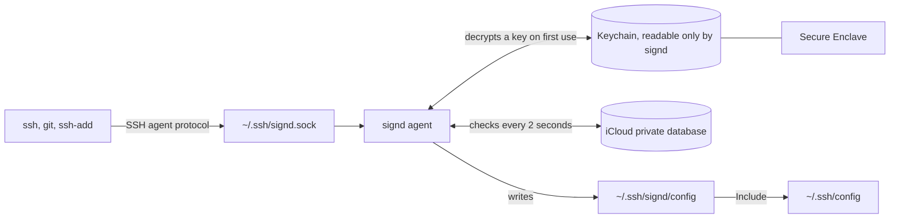
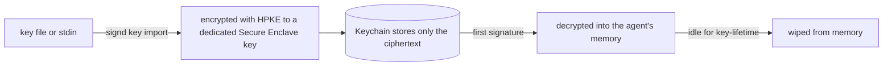
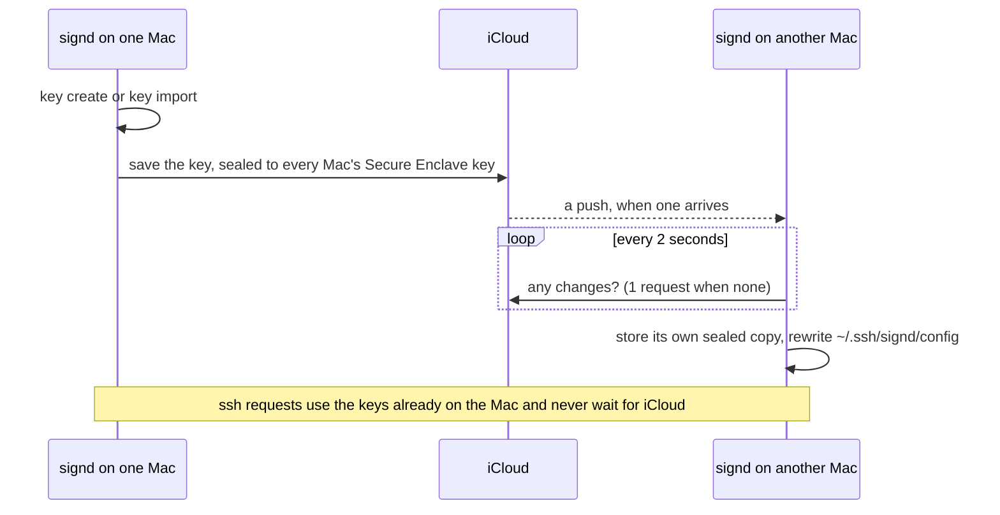

# 

An SSH agent for macOS backed by the [Secure Enclave][secure-enclave].

Create new keys, or import the Ed25519, Elliptic Curve Digital Signature Algorithm (ECDSA) and Rivest-Shamir-Adleman (RSA) keys you already have.
Signed in to your Apple account, every Mac shares them through iCloud.



Listing keys takes under a millisecond, and a Secure Enclave signature about 5 ms.
No command can export a private key.

## Install

Each release attaches `signd.pkg`, signed with a Developer ID, notarized and stapled.
It installs `/Applications/Signd.app`, links `signd` into `/usr/local/bin`, and starts the agent for the user at the console.
The app's provisioning profile grants it a private keychain access group.

Install the package from the [latest release](https://github.com/victor-software-house/signd/releases/latest):

```sh
curl -fLO https://github.com/victor-software-house/signd/releases/latest/download/signd.pkg
sudo installer -pkg signd.pkg -target /
```

Or install it with Homebrew, which also upgrades it:

```sh
brew install --cask victor-software-house/tap/signd
```

A Mobile Device Management (MDM) server installs it with no step on the Mac: see [Deploy with MDM](#deploy-with-mdm).

The agent then runs at login, on `~/.ssh/signd.sock`.
When nobody was logged in during the install, enable it yourself.
Then point SSH at it:

```sh
signd service enable                     # run the agent at login, on ~/.ssh/signd.sock
export SSH_AUTH_SOCK=~/.ssh/signd.sock   # or IdentityAgent ~/.ssh/signd.sock in ~/.ssh/config
```

> [!IMPORTANT]
> For keys with hosts, add this line to `~/.ssh/config`, before any `Host` block:
>
> ```text
> Include ~/.ssh/signd/config
> ```

## Deploy with MDM

An organization can deploy signd to its Macs through its Mobile Device Management (MDM) server, with no prompt and no step on any Mac.
Each release attaches two files for that: `signd.pkg` and `signd.mobileconfig`.

1. Deploy `signd.pkg` with the MDM's package install.
   Besides the app, it installs a login hook, `/Library/LaunchAgents/com.victor-software-house.signd.login.plist`.
   At each user's login the hook runs `signd service enable --at-login`.
   So every user of the Mac gets the agent, including a user who logs in after the install.
   The command exits at once when the agent is set up, and never opens System Settings.
2. Push `signd.mobileconfig` to the Macs.
   It is an unsigned profile: sign it or edit it as your MDM needs.
   Its payload identifiers are fixed, so a newer release replaces it.

The profile has one managed login items payload, `com.apple.servicemanagement`.
macOS 13 or later accepts it only from an MDM, on the device channel.
Its one rule has these values, for an admin who writes the profile by hand:

| Key | Value |
|:--|:--|
| `RuleType` | `BundleIdentifier` |
| `RuleValue` | `com.victor-software-house.signd` |
| `TeamIdentifier` | the signing team, which `codesign -dv /Applications/Signd.app` prints |

The rule approves the login items of the app `com.victor-software-house.signd`, and only when that team signed it.
Those are the agent and the login hook.
It grants nothing else: no other app of the team, and no permission besides running those items.
macOS shows one notice that managed items were installed, and no approval prompt.

A rule by label does not fit.
From macOS 26, a rule by bundle identifier, prefix or team approves tasks that outlive their app without a prompt.
A label rule does not.

A rule by team alone would approve every login item the team ever ships.
A rule by bundle identifier alone matches any app that copies the identifier.
So the `TeamIdentifier` key limits it.

Without the profile, macOS shows each user a notice once, and the user approves signd's login items in System Settings.
Until then, `signd status` shows the approval as missing.

To remove signd from a Mac, delete the package's files and the profile.
Remove the hook in each user's session, then delete its file:

```sh
launchctl bootout gui/$(id -u)/com.victor-software-house.signd.login   # as each logged-in user
sudo rm /Library/LaunchAgents/com.victor-software-house.signd.login.plist
```

`brew uninstall --cask signd` unregisters the login item of the user who runs it, and deletes the hook and the app.

Another user of that Mac keeps a login item that points at the deleted app.
launchd cannot start it.
Nothing registers it again, since the hook is gone.
Remove that item from the user's Login Items, or reinstall signd.

## Keys

```sh
signd key create work --host github.com      # a Secure Enclave P-256 key; prints its public key
signd key create ci --type ed25519           # an Ed25519 key, sealed to the Secure Enclave; also rsa-3072 and rsa-4096
signd key import old ~/.ssh/id_rsa           # an existing private key file in OpenSSH, `PKCS#1`, `PKCS#8` or SEC1 format
signd key import ci - < ci_ed25519           # the same from stdin, for a key that has no passphrase
signd key list
signd key delete old
```

| Key type | Stored as | `key create` | `key import` |
|:--|:--|:--|:--|
| P-256 | Secure Enclave key | default | yes, as a wrapped key |
| Ed25519 | wrapped key | `--type ed25519` | yes |
| ECDSA P-384, P-521 | wrapped key | no | yes |
| RSA, 2048 to 8192 bits | wrapped key | `--type rsa-3072`, `--type rsa-4096` | yes |
| RSA under 2048 bits, Digital Signature Algorithm (DSA) | not supported | no | no |

The Secure Enclave only supports P-256, so signd encrypts every other key with a Secure Enclave key:



To import a key with a passphrase, pass the file path.
signd runs the system `ssh-add` to ask for the passphrase and decrypt the key, then receives it over a socket only you can open.
The decrypted key is never written to disk.

| Added with | Stored in | Removed with |
|:--|:--|:--|
| `signd key create`, `signd key import` | the keychain | `signd key delete` |
| `ssh-add` | memory only, respecting `ssh-add -t` | `ssh-add -D` |
| another Mac, through iCloud | the keychain, as a wrapped key | `signd key delete` on any Mac |

## Keys through iCloud

signd shares keys between the Macs signed in to one Apple account, through that account's iCloud private database.
Each Mac makes its own Secure Enclave key.
Every shared key is sealed to each Mac's key before it leaves the Mac.
Neither Apple nor the signd team can read it.



| Key | Shared |
|:--|:--|
| `key create --type ed25519`, `rsa-3072`, `rsa-4096` | yes, unless `--local` |
| `key import` | yes, unless `--local` |
| `key create`, a Secure Enclave P-256 key | never: it cannot leave the Mac |
| added with `ssh-add` | never: it stays in memory |

```sh
signd key import deploy ~/.ssh/deploy --host git.example.com   # stored here, and shared with every Mac
signd key create scratch --type ed25519 --local                # stays on this Mac
signd key share old                                            # share a key made before
signd key delete deploy                                        # deleted on every Mac
signd device list                                              # the Macs on the account
signd device remove device-0123…                               # forget a Mac that is gone, and drop its copies; run again if it fails
signd sync                                                     # check iCloud now, wait, and print what changed
signd status                                                   # iCloud state, the last and next check, keys waiting or skipped
```

- A new Mac on the account gets every shared key at the next check of a Mac that has them.
  No command is needed on either Mac.
- A check with no change costs one request.
  After a failure signd waits longer each time, up to a minute.
  After a throttle it waits the time iCloud gives.
- A key whose name a key on this Mac already has is skipped and shown in `signd status` until that key is deleted.
- Signing in to another Apple account, or deleting signd's data in iCloud settings, removes the keys other Macs shared.
  Each key this Mac made or imported stays, as a local key.

> [!NOTE]
> Sharing needs the notarized release: only its provisioning profile grants signd's iCloud container.
> A build from source keeps every key on its Mac, and `signd status` shows sync as off.

## TLS identities

A TLS client identity is a Secure Enclave key with the certificate chain a certificate authority signed for it.
signd makes the key and stores the chain.
It does not choose the subject, the authority, or the program that presents the identity.

```sh
signd tls create mirror                                             # a Secure Enclave P-256 key; prints nothing
signd tls csr mirror --common-name mirror --organization Example   # a certificate signing request, in PEM
signd tls store mirror < chain.pem                                  # the PEM chain the authority returned, leaf first
signd tls remove mirror                                             # deletes the key and its chain
```

`csr` signs the request with the key and takes the common name and, when given, the organization as the subject.
Send the request to your own authority, and pipe the chain it returns to `store`.
`store` refuses a chain whose leaf carries another key, and keeps what was stored before.

The identities live in the keychain group `com.victor-software-house.identities`, which the entitlements list after signd's own group.
Another app of the same team reaches them by listing that group in its own entitlements.

The release's Developer ID profile must allow the group; a profile that lists `<team>.*` does.
An identity stays on its Mac: iCloud never shares it, no backup copies it, and the SSH agent never offers it.

## Backup to 1Password

A Mac that stores a 1Password service account token copies the shared keys to a vault.
`signd backup restore` brings them back, through the agent, which is the only process that reads the token.

```sh
signd backup restore                  # list the keys of the backup: name, scope and fingerprint
signd backup restore deploy           # restore one key, shared with every Mac
signd backup restore --all --local    # restore every key, kept on this Mac
signd backup status                   # whether the backup is on, its last run and its next run
```

- A key the store already has is skipped, and so is a key whose name another key uses.
  The command exits non-zero when a key fails, such as one with a passphrase.
- `signd status` prints the same backup lines.
  `backup  off; run signd backup login` shows that no token is stored.

## Updates

A launch daemon, the updater, checks the latest GitHub release of signd and installs a newer one by itself.
It installs the app only when it is notarized and signed by the running updater's team with the identifier `com.victor-software-house.signd`.

The updater then restarts each user's agent on the new version.
The app stays owned by root, so no user process can change it.

```sh
signd update    # check now, install a newer release, and report the result
```

- `signd status` shows whether updates are on, the interval, where each came from, and the last check with its error.
- The updater reads two settings from the machine-wide preferences, never from a user's.
  `updates` is a boolean, on by default, and `update-interval` is a duration from 1h to 30d, 6h by default.
- A Mobile Device Management (MDM) profile sets them in its `com.victor-software-house.signd` preference domain, and its values win.
  An admin sets them with `sudo defaults write /Library/Preferences/com.victor-software-house.signd updates -bool false`.

## Settings

| Setting | Default | Range | Controls |
|:--|:--|:--|:--|
| `interval` | 2s | 1 second to 1 hour | how often signd checks iCloud for changes |
| `key-lifetime` | 1h | 1 second to 30 days | how long a decrypted key stays in memory when idle |

- `signd config set interval 10s` sets a value on this Mac, and `signd config unset interval` removes it.
- Values are durations such as `30s`, `5m`, `1h` or `2d`; signd rejects one out of range.

## Operation

| Part | Behaviour |
|:--|:--|
| Service | `signd service enable` registers the agent's LaunchAgent with `SMAppService`; launchd runs `signd serve` at login and restarts it if it exits. |
| Protocol | The SSH agent protocol (RFC 9987): list, sign, add, remove, and the `query` and `session-bind@openssh.com` extensions. Lock, confirm and every other request are refused. |
| Locked Mac | Keys work without a prompt once the Mac has been unlocked after boot, so signd also signs on a locked or headless Mac. |
| Output | Every command that prints data takes `--json`. |

## Development

`openspec/` contains the requirements and the planned changes, and `tasks.yaml` is the work queue.
CI builds and tests on GitHub-hosted runners.
Xcode builds the app bundle from `project.yml`: `mise run app` builds it unsigned, and the Release workflow archives and exports it signed.
`App/Signd.entitlements` derives the iCloud container from the bundle identifier.

> [!NOTE]
> GitHub-hosted runners have no Secure Enclave, so `mise run e2e:hardware` tests Secure Enclave keys on a Mac before each release.

## License

[GNU Affero General Public License v3.0](LICENSE).

[secure-enclave]: https://support.apple.com/guide/security/the-secure-enclave-sec59b0b31ff/web
